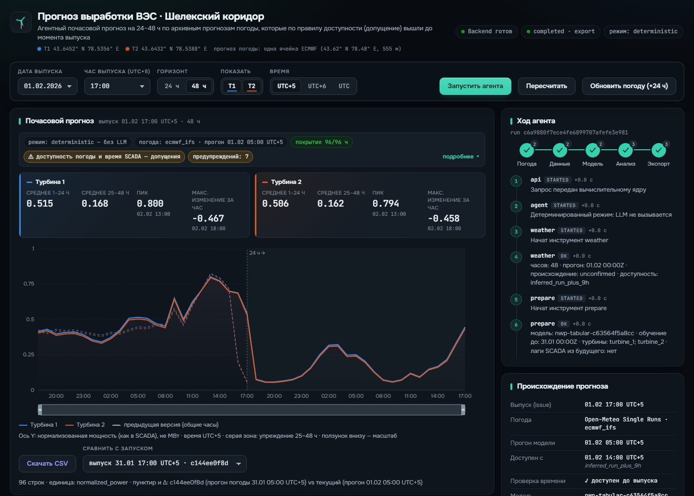
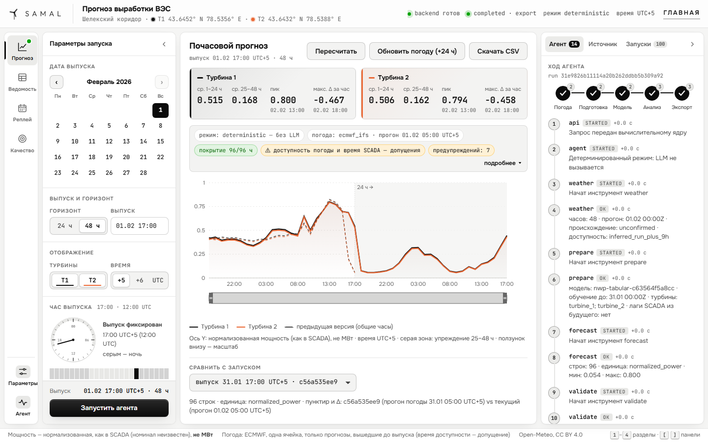
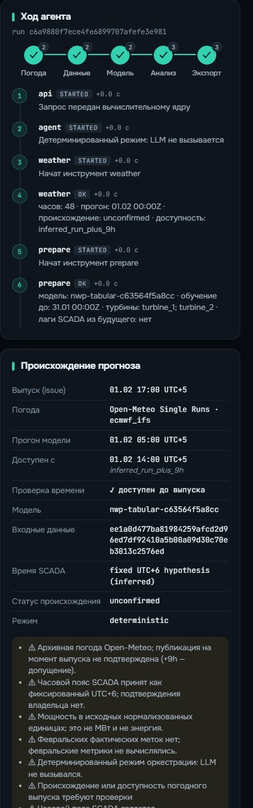
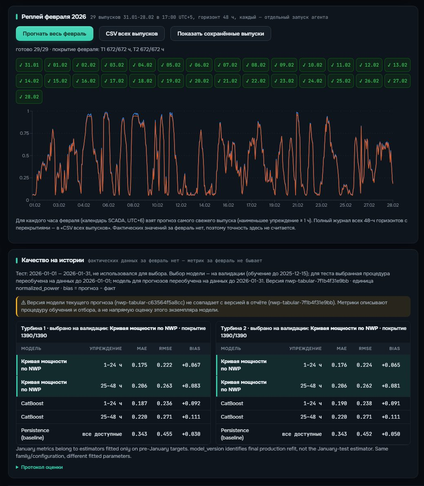
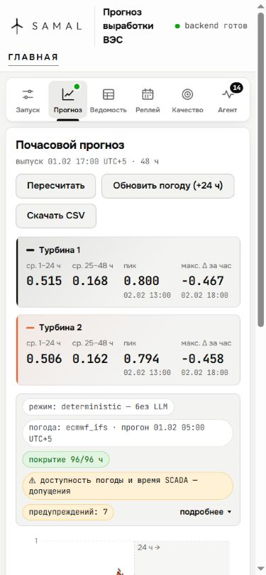

# SAMAL
### A wind forecast with a memory of what was knowable at the time.

An hourly **24–48 hour power-forecasting workspace for two wind turbines in the Shelek corridor**. SAMAL joins a forecasting model, archived weather, a tool-using agent and an interface for comparing forecast revisions.

*A recorded application run: turbine forecasts, an earlier issue on common hours and the agent’s execution trace.*

## The difficult part is the timeline

A forecast can look excellent if it accidentally uses weather that was published later or measurements from the period it is meant to predict. SAMAL makes the issue time part of the data model. Every forecast needs to know which weather run was available and which SCADA observations were allowed at that moment.

The project assembled **142,360 and 149,499 SCADA observations** for the two turbines, at approximately ten-minute resolution, covering March 2023 through January 2026. Preparation removes duplicate records and builds hourly coverage before fitting and evaluation.

Archived ECMWF forecasts are retrieved through Open-Meteo Single Runs. Raw weather responses retain hashes and provenance. The replay uses an explicit **run time + 9 hours** availability assumption; that assumption is surfaced rather than treated as a measured publication timestamp.

## Inspect the forecast as an operator

The workspace selects issue date, issue time, horizon, turbine and display timezone. It shows hourly normalized power and summary values for the two halves of a 48-hour forecast. A weather update creates another forecast issue rather than overwriting the previous one.

*The desktop workspace keeps model output and execution context together.*

Comparing only overlapping target hours avoids a misleading comparison between two differently positioned horizons. The earlier issue remains visible, and CSV export provides a concrete handoff for further analysis.

## The agent orchestrates; the model calculates

~~~mermaid
flowchart LR
 A[Archived weather] --> B[Prepare aligned inputs]
 B --> C[Forecasting model]
 C --> D[Validate timeline and output]
 D --> E[Forecast ledger and CSV]
 F[Tool-using agent] -. orchestrates .-> A
 F -. orchestrates .-> B
 F -. orchestrates .-> C
 E --> G[Compare issues in the workspace]
~~~

The numerical power estimate comes from the forecasting model. The agent coordinates weather retrieval, preparation, forecasting, validation and export. A deterministic mode follows the same tool path without an LLM, making it possible to inspect the pipeline independently of model-provider availability.

*The trace records actions and provenance so a forecast can be inspected beyond its final curve.*

## Why the simpler model stayed

The evaluation compared learned empirical power curves with a CatBoost baseline. January backtesting covered **1,390 forecast-hour pairs per turbine**, representing **707 unique target hours**. Repeated horizons mean those two counts are not interchangeable.

| January evaluation | Turbine 1 | Turbine 2 |
|---|---:|---:|
| Selected model MAE | 0.190351 | 0.190407 |
| Selected model RMSE | 0.243279 | 0.243430 |
| CatBoost MAE | 0.253398 | 0.254650 |

The values are on the normalized-power scale, not megawatts. Evaluation weights used data before January 1; the later production refit through January 31 is a different model state and is not assigned the same backtest score.

Neural experiments explored MLP and transformer variants on a T4, with 60 checkpoints and 12 CatBoost comparisons in the documented research. Mean improvements were not sufficiently stable in uncertainty checks to justify replacing the selected version. Keeping the simpler model was an experimental conclusion, not an absence of further modelling work.

## Replay is not ground truth

The February replay generated **29 daily issues**, **2,784 ledger rows** and **1,344 selected forecast values**. Observed February power was unavailable in that replay, so these are completeness and pipeline results—not February accuracy metrics.

*Issue history and replay metrics expose what ran and which outputs were retained.*

Mobile workspace

*The mobile capture preserves the forecast controls and result inspection on a narrower display.*

The implemented result is a forecast workflow whose inputs, issue times and revisions can be examined. Its most important constraint is explicit: all reported accuracy belongs to the documented January evaluation, while later replay demonstrates operational reproducibility.

---

### Built by

**QwertyS** — [Shakhnazar Akhmer](https://github.com/Eye172) and [Nurkhan Aimukatov](https://github.com/pip00sya).

[More projects](https://github.com/Eye172) · [Contact](mailto:shakh090909@gmail.com)

This repository presents the product and its engineering. The implementation is maintained separately. Screenshots and documented experiments are identified in their captions; a live deployment is not required to explore the case study.
