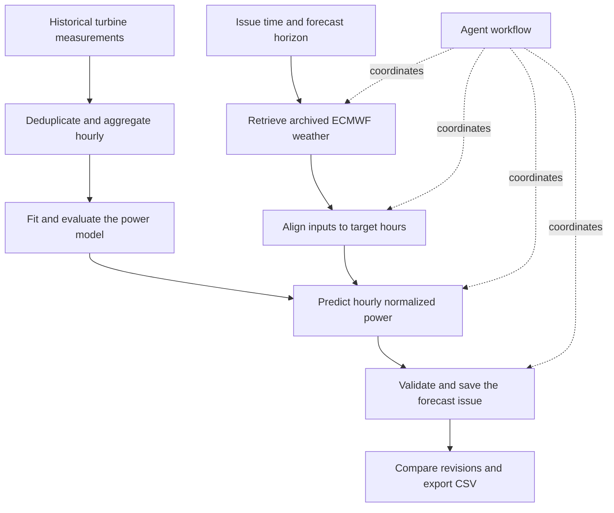

# SAMAL

### Hourly wind-power forecasts, with every revision explained.

SAMAL is a forecasting workspace for **two wind turbines in Kazakhstan's Shelek corridor**. It combines historical turbine measurements, archived weather forecasts and an agent workflow to estimate power output **24–48 hours ahead**. An operator can inspect both turbines, compare forecast revisions, follow the calculation steps and export the result.

[The case](#the-case) · [Walkthrough](#from-weather-to-an-operator-decision) · [Architecture](#how-it-works) · [Results](#results) · [Engineering notes](docs/ENGINEERING.md) · [Certificate](docs/awards/README.md)

*The operator workspace: choose a forecast issue on the left, inspect power output in the centre and follow the run on the right.*

| Scope | Delivered |
|---|---|
| Forecast | Hourly normalized power for two turbines, over 24 or 48 hours |
| Workflow | Archived weather → preparation → prediction → validation → export |
| Interface | Issue controls, forecast comparisons, run history, replay and CSV export |
| Event | HackAlem AI 2026 · Energy track · **84/100** |

## The case

Samruk-Kazyna's [HackAlem AI challenge](docs/HACKATHON.md) asked teams to build an agentic system for forecasting wind-farm output. The practical question was: **what will the turbines produce over the next one or two days, and how does that estimate change when the weather forecast updates?**

A useful answer needs more than a curve. The operator needs to know when it was issued, which weather forecast informed it, how it differs from the previous estimate and which values can be handed off for further analysis. SAMAL brings that context into the same workspace as the prediction.

The central engineering problem is time: a historical forecast must use information available when it would have been issued. Training on later measurements or retrieving later weather can make a backtest look better without improving the actual forecasting workflow. SAMAL records issue times, weather runs and model versions so those decisions remain inspectable.

## From weather to an operator decision

The captured example starts at **1 February 2026, 17:00 UTC+5**, with a **48-hour** horizon and both turbines selected.

1. **Choose the issue.** Set the issue date and time, select 24 or 48 hours, choose the turbines and adjust the display timezone.
2. **Run the workflow.** The agent coordinates weather retrieval, input preparation, prediction, validation and export. Its panel shows progress and the individual tool steps.
3. **Read the output.** Inspect the hourly curves, averages for hours 1–24 and 25–48, peak output and the largest hourly change. Output uses the dataset's normalized-power scale.
4. **Compare revisions.** Select an earlier issue and compare the curves on their shared target hours. Updating the weather produces another issue while preserving the earlier forecast.
5. **Export or inspect history.** Download the forecast as CSV, revisit saved runs or replay successive issue dates across February.

*The recorded dark interface shows both turbine curves, an earlier forecast as dashed lines, summary values and the execution trace.*

Mobile workspace

## How it works

**Data.** The supplied turbine files contain **142,360 and 149,499 observations**, from March 2023 through January 2026. Preparation removes duplicate records and checks hourly coverage. Archived ECMWF forecasts are retrieved through Open-Meteo Single Runs.

**Forecasting.** A learned empirical power curve maps weather inputs to turbine output. CatBoost and neural alternatives were explored during model development. The numerical estimate comes from the forecasting model; the agent coordinates the workflow around it.

**Execution.** A deterministic mode follows the same tool sequence without an LLM. The recorded demonstrations show this mode. Each saved issue retains its input and model context, while the interface exposes progress, assumptions and run history.

Inspect the execution trace and forecast provenance

*The trace connects the displayed forecast to its weather run, model and processing steps.*

## Results

### Forecast evaluation

The documented January backtest covered **1,390 forecast-hour pairs per turbine**, representing **707 unique target hours**. Multiple forecast issues can predict the same hour, which explains the different counts.

| Selected model · January evaluation | Turbine 1 | Turbine 2 |
|---|---:|---:|
| Mean absolute error (MAE) | 0.190351 | 0.190407 |
| Root mean squared error (RMSE) | 0.243279 | 0.243430 |

Both metrics measure error on the **normalized-power scale**; lower is better. January evaluation used model weights fitted before 1 January. The later refit through 31 January is a separate model state.

The simpler model remained selected after the documented neural experiments did not show sufficiently stable improvements. [Model comparisons, experiment scope and evaluation details](docs/ENGINEERING.md#why-the-simpler-model-stayed).

### Historical replay

The February replay completed **29 daily issues**, retaining **2,784 forecast-ledger rows** and **1,344 selected hourly forecasts** across the two turbines. It demonstrates the repeated weather-to-export workflow across the test period. February observations were absent from the supplied files, so the reported accuracy metrics belong to January.

*The replay view connects saved daily issues to the month-wide forecast. The evaluation panel below reports the separate January backtest.*

### HackAlem AI

SAMAL received **84/100** in the **Energy track** at [HackAlem AI](https://hackalem.ai/), held in Astana on **23 September 2026**. The team did not advance to the final.

The participation certificate records the event's GUINNESS WORLD RECORDS title: **“Most Participants in an Agentic AI Hackathon.”** [Astana Hub's announcement](https://astanahub.com/en/article/mezhdunarodnyi-ai-khakaton-hackalem-ai-ustanovil-mirovoi-rekord-guinness-world-records) covers the event's record.

[Certificate and result screenshot](docs/awards/README.md) · [Challenge, rubric and official links](docs/HACKATHON.md)

## What the prototype establishes

The delivered workflow connects data preparation and forecasting to an interface where a person can inspect, compare and export results. Keeping forecast revisions and their input context makes the result easier to investigate than a standalone prediction script.

The next engineering steps are to evaluate against observed February output, confirm the source timezone and weather publication timings, and validate the workflow with an operator. The current replay uses a documented **weather run + 9 hours** availability assumption. These are the boundaries of the recorded prototype and the work needed to take it further.

## Explore the project

| Material | What it contains |
|---|---|
| [Engineering and evaluation](docs/ENGINEERING.md) | Data preparation, issue-time handling, model experiments and replay details |
| [Challenge and scoring](docs/HACKATHON.md) | Samruk-Kazyna case, train/test periods, original brief and scoring rubric |
| [Certificate and result](docs/awards/README.md) | Participation certificate and the platform's 84-point result |
| [Official event website](https://hackalem.ai/) | HackAlem AI overview and programme |
| [Challenge portal](https://learn.spira.to/hackathons/df4743f5-c492-415c-b45a-1f13adb78e06?tab=tracks) · [Results portal](https://learn.spira.to/hackathons/df4743f5-c492-415c-b45a-1f13adb78e06?tab=solutions) | Organizer's task and submission pages; participant access may require sign-in |

This repository is the public case study. The implementation is maintained separately; the full turbine datasets are not distributed here.

### Built by

**QwertyS** — [Shakhnazar Akhmer](https://github.com/Eye172) and [Nurkhan Aimukatov](https://github.com/pip00sya).

[More projects](https://github.com/Eye172) · [Contact](mailto:shakh090909@gmail.com)
