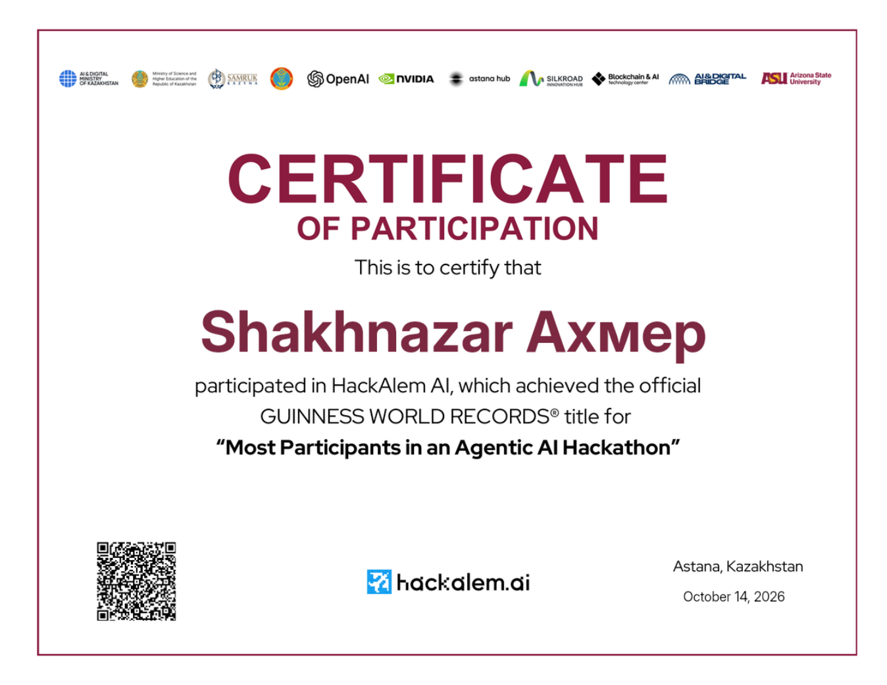
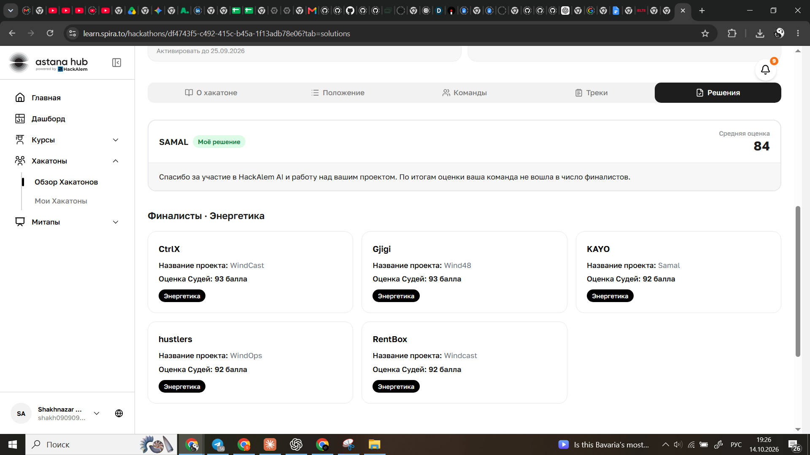

# HackAlem AI · certificate and result

**SAMAL · QwertyS · Energy track · 84/100**

SAMAL participated in HackAlem AI on **23 September 2026**. The platform reports an overall score of **84** and confirms that the team did not advance to the final. The task's evaluation rubric totals 100 points.

## Participation certificate

Issued to **Shakhnazar Akhmer** in Astana on **14 October 2026**. The certificate records participation in the event that achieved the GUINNESS WORLD RECORDS title **“Most Participants in an Agentic AI Hackathon”**.

[Open original PDF](hackalem-ai-participation.pdf)

## Evaluation result

[Open the supplied result screenshot](samal-result-84.png) · [Platform results](https://learn.spira.to/hackathons/df4743f5-c492-415c-b45a-1f13adb78e06?tab=solutions)

View the platform result: SAMAL, 84 points

[Event website](https://hackalem.ai/) · [Astana Hub's record announcement](https://astanahub.com/en/article/mezhdunarodnyi-ai-khakaton-hackalem-ai-ustanovil-mirovoi-rekord-guinness-world-records) · [Challenge and rubric](../HACKATHON.md)

The PDF and platform screenshots are the supplied originals. The certificate preview is rendered from the PDF.

[Back to SAMAL](../../README.md)
